# Modèle de données

Version 1, novembre 2026. Ce document décrit les tables de l'application. Il évolue avec le projet : chaque changement de modèle met aussi ce fichier à jour.

Le code est en anglais (carte T14b). Les noms des modèles, des champs et des valeurs enregistrées ci-dessous sont ceux du code. Le lien avec les anciens noms français est dans `docs/glossaire.md`. Les tables encore à venir ont déjà leur nom anglais.

## Principes

1. **Le compte appartient à la personne, pas à la chambre.** La chambre est une information du séjour. Un séjour relie une personne à une chambre entre deux dates. On garde l'historique des occupants.
2. **Modèle utilisateur personnalisé dès le départ.** La documentation de Django recommande de le créer avant la première migration, car le changer plus tard est complexe. Tous les liens vers un utilisateur passent par `settings.AUTH_USER_MODEL`.
3. **On ne stocke jamais un secret en clair.** Le code d'activation et le code SMS sont hachés. Le mot de passe wifi est chiffré, car il doit pouvoir être réaffiché.
4. **Les votes restent anonymes.** On note qui a voté (pour empêcher un double vote) dans une table, et le choix dans une autre table, sans lien vers la personne.
5. **Les envois sont traçables.** Chaque message envoyé à une personne, sur un canal, laisse une ligne avec son statut.

## Applications Django

| Application | Contenu |
|---|---|
| `accounts` | Utilisateur, rôles, code d'activation, vérification du téléphone |
| `push` | Appareils abonnés aux notifications Web Push, envoi, clé VAPID |
| `access` | Connexion par clé d'accès, confirmation avant une action sensible, durée des sessions. Les clés sont les modèles de la bibliothèque django-otp-webauthn |
| `housing` | Étages, chambres, séjours, accès wifi (chaque affichage d'un mot de passe va dans le journal d'audit) |
| `messaging` | Modèles de message, campagnes, envois, réponses de présence, notifications dans l'appli |
| `polls` | Sondages, options, participations, votes |
| `appointments` | Disponibilités, rendez-vous, réglages des éducateurs, messages directs |
| `reports` | Signalements, photos, historique des événements |
| `audit` | Journal d'audit des actions sensibles |
| `discussion` | Phase 2 : salons entre résidents et modération |

## Schéma

```mermaid
erDiagram
    USER ||--o{ STAY : "occupe"
    ROOM ||--o{ STAY : "accueille"
    FLOOR ||--o{ ROOM : "contient"
    ROOM ||--o{ WIFI_ACCESS : "possède"
    USER ||--o{ ACTIVATION_CODE : "reçoit"
    USER ||--o{ PHONE_VERIFICATION : "vérifie"
    USER ||--o{ PASSKEY : "se connecte avec"
    USER ||--o| WEBAUTHN_USER_HANDLE : "est désigné par"
    USER ||--o{ PUSH_SUBSCRIPTION : "s'abonne"
    USER }o--o{ ROLE_GROUP : "a pour rôles"

    MESSAGE_TEMPLATE ||--o{ CAMPAIGN : "sert de base"
    USER ||--o{ CAMPAIGN : "rédige"
    CAMPAIGN }o--o{ FLOOR : "cible"
    CAMPAIGN }o--o{ ROOM : "cible en plus"
    CAMPAIGN }o--o{ USER : "ajoute ou retire"
    CAMPAIGN ||--o{ DELIVERY : "produit"
    USER ||--o{ DELIVERY : "reçoit"
    CAMPAIGN ||--o{ ATTENDANCE_REPLY : "recueille"
    USER ||--o{ NOTIFICATION : "reçoit"

    CAMPAIGN ||--o| POLL : "porte"
    POLL ||--o{ POLL_OPTION : "propose"
    POLL ||--o{ PARTICIPATION : "enregistre"
    USER ||--o{ PARTICIPATION : "a voté"
    POLL_OPTION ||--o{ VOTE : "reçoit"

    USER ||--o{ AVAILABILITY : "ouvre"
    USER ||--o{ APPOINTMENT : "réserve ou reçoit"
    USER ||--o{ CONVERSATION : "participe"
    CONVERSATION ||--o{ DIRECT_MESSAGE : "contient"

    USER ||--o{ REPORT : "crée ou traite"
    ROOM ||--o{ REPORT : "concerne"
    REPORT ||--o{ REPORT_PHOTO : "illustre"
    REPORT ||--o{ REPORT_EVENT : "historise"

    USER ||--o{ AUDIT_ENTRY : "agit"

    USER {
        int id PK
        string username UK
        string first_name
        string last_name
        string phone UK "portable, format E.164, unique s'il est renseigné"
        string email "facultatif"
        bool is_active
        string verified_phone "numéro confirmé par SMS ; vérifié seulement s'il égale phone"
        datetime phone_verified_at
    }
    FLOOR {
        int id PK
        int number UK "0 = rez-de-chaussée"
        string name
        int visit_order "rotation des visites"
    }
    ROOM {
        int id PK
        string number UK
        int floor_id FK
        bool active "fermée : travaux, bureau…"
    }
    STAY {
        int id PK
        int resident_id FK
        int room_id FK
        date arrival
        date departure "vide si en cours"
        date planned_departure "départ prévu, enregistré ce jour-là à midi"
    }
    WIFI_ACCESS {
        int id PK
        int room_id FK
        string username "un seul accès actif par identifiant"
        text encrypted_password "Fernet, jamais en clair"
        bool generated "mot de passe généré par l'application"
        date created_on
        date expires_on "created_on + 1 an par défaut"
        int created_by_id FK
        bool active "un seul actif par chambre"
        datetime ended_at
        string end_reason "renewed, departure, move"
        datetime reminder_sent_at "rappel au résident, 15 jours avant"
    }
    WIFI_SETTINGS {
        int id PK "toujours 1"
        string network_name "nom du réseau (SSID)"
        int username_length "6 par défaut"
        int password_length "6 par défaut"
        string alphabet "caractères des accès générés"
    }
    ACTIVATION_CODE {
        int id PK
        int user_id FK
        string digest UK "HMAC-SHA256, jamais le code"
        int created_by_id FK
        datetime created_at
        datetime expires_at "création + 72 h"
        datetime used_at
        datetime cancelled_at "remplacé par un code plus récent"
        bool for_staff "remis par un administrateur (T14)"
    }
    ACTIVATION_FAILURE {
        int id PK
        string ip_address "50 échecs par heure et par adresse au plus"
        datetime created_at
    }
    PHONE_VERIFICATION {
        int id PK
        int user_id FK
        string phone "numéro au moment de l'envoi"
        string digest "HMAC-SHA256, jamais le code"
        datetime created_at
        int attempts "5 au plus"
        datetime expires_at "création + 10 min"
        datetime verified_at
    }
    PASSKEY {
        int id PK
        int user_id FK
        string credential_id_sha256 UK "recherche rapide"
        binary credential_id "créé par l'appareil"
        binary public_key "clé publique COSE ; la clé privée reste sur l'appareil"
        int sign_count
        json transports
        bool discoverable "obligatoire : connexion sans identifiant"
        bool confirmed
        datetime created_at
        datetime last_used_at
    }
    WEBAUTHN_USER_HANDLE {
        int user_id PK
        string handle_hex UK "64 octets aléatoires, jamais l'identifiant du compte"
    }
    PUSH_SUBSCRIPTION {
        int id PK
        int user_id FK
        string endpoint UK "jamais affiché ni journalisé"
        string p256dh
        string auth
        string device "par exemple Safari sur iPhone"
        datetime created_at
        datetime last_success_at
        int failures "supprimé à 5"
    }
    MESSAGE_TEMPLATE {
        int id PK
        string type "visit, maintenance, announcement, vote, custom"
        string name UK "unique par type"
        string title "titre de la notification"
        text body "avec {champs}"
        text sms_body
        bool reply_expected
    }
    CAMPAIGN {
        int id PK
        string type "visit, maintenance, announcement, vote, custom"
        string title
        text body "texte complet, avec {champs}"
        text sms_body "version courte"
        string reply_type "none, attendance"
        date event_date "valeur de {date}"
        time start_time "valeur de {début}"
        time end_time "valeur de {fin}"
        bool everyone "tout le monde"
        string status "draft, scheduled, sending, sent, cancelled"
        datetime send_at
        bool remind "relance le jour J à 8 h"
        datetime remind_at
        datetime started_at
        datetime sent_at
        datetime reminder_started_at
        datetime reminder_sent_at
        int author_id FK
        int template_id FK
    }
    DELIVERY {
        int id PK
        int campaign_id FK
        int recipient_id FK
        string kind "message, reminder"
        string channel "push, sms, none"
        string status "pending, sending, sent, failed"
        string room_number
        string title "texte envoyé"
        text body
        text sms_text
        int segments
        string provider_message_id
        string error
        int attempts
        datetime next_attempt_at
        datetime claimed_at
        datetime sent_at
        datetime read_at
    }
    ATTENDANCE_REPLY {
        int id PK
        int campaign_id FK
        int resident_id FK
        string value "present, absent"
        datetime replied_at
    }
    NOTIFICATION {
        int id PK
        int user_id FK
        string title
        string text
        string link
        datetime created_at
        datetime read_at
    }
    POLL {
        int id PK
        int campaign_id FK
        string question
        datetime closes_at
        bool comment_allowed
    }
    POLL_OPTION {
        int id PK
        int poll_id FK
        string label
        int position
    }
    PARTICIPATION {
        int id PK
        int poll_id FK
        int resident_id FK
        datetime voted_at
    }
    VOTE {
        int id PK
        int option_id FK
        text comment "pas de lien vers la personne"
    }
    AVAILABILITY {
        int id PK
        int educator_id FK
        int weekday "0 = lundi"
        time start
        time end
        date valid_from
        date valid_until
    }
    APPOINTMENT {
        int id PK
        int educator_id FK
        int resident_id FK
        datetime start
        datetime end
        string reason "liste courte, facultatif"
        text private_note "visible par l'éducateur seul"
        string status "confirmed, cancelled, attended, no_show"
    }
    CONVERSATION {
        int id PK
        int resident_id FK
        int staff_member_id FK
        datetime updated_at
    }
    DIRECT_MESSAGE {
        int id PK
        int conversation_id FK
        int author_id FK
        text text
        datetime sent_at
        datetime read_at
    }
    REPORT {
        int id PK
        string number UK
        int resident_id FK
        int room_id FK
        string category "electricity, plumbing, pests, furniture, heating, other"
        text description
        string urgency "can_wait, annoying, urgent"
        bool access_allowed
        string status "new, acknowledged, scheduled, done, closed"
        int assigned_to_id FK
        datetime due_at "selon l'urgence"
        datetime intervention_start
        datetime intervention_end
        datetime last_resident_reminder_at
        datetime created_at
        datetime updated_at
    }
    REPORT_PHOTO {
        int id PK
        int report_id FK
        string image
    }
    REPORT_EVENT {
        int id PK
        int report_id FK
        int author_id FK
        string type "created, acknowledged, scheduled, intervention, confirmed, reopened, reminder, closed"
        text note
        datetime created_at
    }
    AUDIT_ENTRY {
        int id PK
        datetime created_at
        int actor_id FK "vide si le compte est supprimé"
        string actor_label "nom gardé pour la lecture"
        string action "roles_changed, activation_code_issued, wifi_password_shown, resident_departed, resident_returned, passkey_created, access_cut, wifi_access_set"
        int target_type_id FK "type de l'objet concerné"
        string target_id
        string target_label
        json details "par exemple les rôles avant et après"
        string ip_address
    }
```

## Rôles, groupes et permissions

**Un rôle est un groupe Django** (table `auth_group`, liée au compte par `groups`). Une personne peut avoir plusieurs rôles, par exemple Accueil et Maintenance : ses droits sont la somme de ceux de ses groupes. Un résident est un compte sans rôle du personnel. Dans l'administration, les rôles se choisissent par cases à cocher.

Les groupes et leurs permissions sont recréés à chaque `migrate` (signal `post_migrate`) : le code de `accounts/roles.py` fait foi, un ajout fait à la main est retiré.

Dans le code, chaque rôle a une valeur : `front_desk` (Accueil), `educator` (Éducateurs), `maintenance` (Maintenance), `admin` (Administration), `moderator` (Modérateurs). Les noms des groupes restent en français, car ils s'affichent dans l'administration.

| Permission (`accounts.…`) | Accueil | Éducateurs | Maintenance | Administration | Modérateurs |
|---|:-:|:-:|:-:|:-:|:-:|
| `access_staff_area` | oui | oui | oui | oui | |
| `view_residents` | oui | oui | | oui | |
| `manage_residents` | oui | | | oui | |
| `issue_activation_codes` | oui | | | oui | |
| `view_wifi_password` | | | | oui | |
| `manage_wifi_settings` | | | | oui | |
| `send_messages` | oui | oui | oui | oui | |
| `manage_reports` | oui | | oui | oui | |
| `manage_appointments` | | oui | | oui | |
| `moderate_discussion` | | | | oui | oui |
| `view_audit_log` | | | | oui | |
| `manage_roles` | | | | oui | |

- Un résident n'a aucune permission, sauf s'il a le rôle Modérateur. Ce rôle ne donne pas accès à l'espace équipe.
- `is_staff` (accès à l'administration Django) reste séparé des rôles et se règle à la main.
- Un super-utilisateur créé avec `createsuperuser` reçoit le rôle Administration.

## Journal d'audit

- Une entrée (`AuditEntry`) ne se modifie pas et ne se supprime pas (le modèle refuse avec `AuditEntryImmutable`, l'administration est en lecture seule).
- L'objet concerné est désigné par son type et son identifiant (relation générique `target`) : le journal peut viser un compte, un séjour ou un accès wifi sans changer de table.
- Lecture réservée à la permission `view_audit_log`.

## Clés d'accès (connexion)

- Les tables `PASSKEY` et `WEBAUTHN_USER_HANDLE` viennent de django-otp-webauthn (`WebAuthnCredential`, `WebAuthnUserHandle`). Le serveur ne garde que la clé publique.
- La clé est créée à l'étape 3 de l'activation. Une nouvelle activation (téléphone perdu) supprime les anciennes clés et ferme les autres sessions.
- Le départ d'un résident supprime ses clés (signal `departure_recorded`) ; le nombre va au journal.
- Supprimer une clé, par n'importe quel chemin, ferme les sessions du compte (signal `post_delete`). La fiche du résident propose « Couper l'accès » pour un téléphone perdu.
- Changer les rôles d'une personne ferme ses sessions : ses droits et la durée de sa session changent.
- Aucun mot de passe (T14) : le backend `PermissionsOnlyBackend` lit les permissions des rôles et refuse toute connexion par mot de passe. L'espace équipe et l'administration exigent une session vérifiée par clé.
- Un code d'activation `for_staff` ne sert qu'à un compte du personnel, un code de l'accueil qu'à un résident.
- Durée des sessions (repart à chaque requête) : 90 jours sans activité pour un résident connecté par clé, 12 heures pour le personnel. Une action sensible demande une vérification par clé de moins de 10 minutes.

## Accès wifi

- Un accès par chambre, valable un an par défaut. Le renouvellement garde l'ancien, inactif, pour l'historique.
- Le mot de passe est chiffré avec Fernet (bibliothèque cryptography). Les clés sont dans `DJANGO_WIFI_KEYS`, jamais dans le dépôt ; `python manage.py rotate_wifi_keys` chiffre de nouveau avec une nouvelle clé.
- La fin d'un séjour (départ, changement de chambre) coupe l'accès de la chambre : il faut le changer sur le réseau.
- Pas de table des consultations : chaque affichage d'un mot de passe est une entrée du journal d'audit (`wifi_password_shown`).
- Le format du portail captif (`WIFI_SETTINGS`, une seule ligne) se règle dans l'administration : longueurs et caractères des accès générés. Les accès saisis à la main restent libres, de 4 à 64 caractères sans espace.
- La liste existante s'importe depuis un fichier CSV ou Excel, avec aperçu puis confirmation (administrateurs seulement).
- Le résident voit l'accès de sa chambre sur `/wifi/`. Le mot de passe s'affiche après une confirmation par clé d'accès ; chaque affichage va au journal, comme pour l'équipe.
- Rappel au résident 15 jours avant la fin, par notification (commande quotidienne `send_wifi_reminders`), sauf s'il l'a désactivé (`User.wifi_expiry_reminder`). L'équipe a la liste des accès à renouveler dans les 30 jours.

## Envois

- Un `DELIVERY` par personne, par message et par sorte (le message, puis la relance) : la contrainte unique empêche tout doublon, même avec deux *workers*. Chaque envoi est réservé (`sending`) avant de partir ; un envoi resté réservé plus de 10 minutes passe en échec, jamais renvoyé.
- Le texte envoyé (champs remplis) est gardé dans `DELIVERY` : il servira à la boîte de réception (T23).
- La relance va seulement à ceux qui n'ont pas de `ATTENDANCE_REPLY`.

## Notifications

- Un appareil (`PUSH_SUBSCRIPTION`) par navigateur, au plus 10 par personne. Il appartient à la personne qui a appuyé sur « Activer les notifications ».
- L'adresse du service d'envoi permet à n'importe qui d'envoyer à l'appareil : elle n'apparaît dans aucune page, ni dans l'administration ni dans les journaux. Seuls les services de Google, Mozilla, Apple et Microsoft sont acceptés.
- Un appareil est supprimé quand le service d'envoi ne le connaît plus (404, 410), après 5 échecs d'affilée, à la déconnexion de sa session, et quand une clé d'accès du compte est supprimée (téléphone perdu, départ, nouvelle activation).
- La clé VAPID du serveur (`DJANGO_VAPID_PRIVATE_KEY`) n'est jamais dans le dépôt. En changer oblige chaque appareil à réactiver les notifications.

## Règles métier portées par le modèle

| Règle | Où elle vit |
|---|---|
| Une chambre n'a qu'un séjour en cours | Contrainte unique conditionnelle sur `Stay(room)` quand `departure` est vide |
| Un résident n'a qu'un séjour en cours | Même contrainte sur `Stay(resident)` |
| Le départ ne précède pas l'arrivée | Contrainte de vérification sur `Stay` |
| Pas deux séjours qui se croisent, pour une chambre ou une personne | Validation de `Stay` (`clean`), le jour de relève est permis |
| Pas de nouveau séjour dans une chambre fermée | Validation de `Stay` (`clean`) |
| Un seul accès wifi actif par chambre | Contrainte unique conditionnelle sur `WifiAccess(room)` quand `active` est vrai |
| Un identifiant wifi ne sert qu'à une chambre à la fois | Contrainte unique conditionnelle sur `WifiAccess(username)` quand `active` est vrai |
| Un seul vote par sondage et par résident | Contrainte unique sur `Participation(poll, resident)` |
| Un envoi par personne et par canal | Contrainte unique sur `Delivery(campaign, recipient, channel)`, ce qui rend un nouvel essai sans risque de doublon |
| Pas deux rendez-vous au même moment pour un éducateur | Contrainte unique sur `Appointment(educator, start)` et vérification du chevauchement dans une transaction |
| Délai de prise en charge | `due_at` calculé à la création : 4 h (`urgent`), 48 h (`annoying`), 7 jours (`can_wait`) |
| Clôture d'un signalement | Par le résident, ou automatiquement 3 jours après le passage au statut `done` (« Fait ») |

## Phase 2 : discussion entre résidents

Prévue plus tard, avec un rôle « modérateur » (`moderator`) donné par l'équipe à un membre du personnel ou à des résidents.

| Table | Rôle |
|---|---|
| `Channel` | Un salon de discussion (tous, un étage, un sujet) |
| `ChannelMessage` | Un message, avec auteur, texte, date et état masqué ou non |
| `MessageReport` | Un résident signale un message aux modérateurs |
| `Suspension` | Mise en pause d'un résident, avec durée et motif |
