# Modèle de données

Version 1, novembre 2026. Ce document décrit les tables de l'application. Il évolue avec le projet : chaque changement de modèle met aussi ce fichier à jour.

## Principes

1. **Le compte appartient à la personne, pas à la chambre.** La chambre est une information du séjour. Un séjour relie une personne à une chambre entre deux dates. On garde l'historique des occupants.
2. **Modèle utilisateur personnalisé dès le départ.** La documentation de Django recommande de le créer avant la première migration, car le changer plus tard est complexe. Tous les liens vers un utilisateur passent par `settings.AUTH_USER_MODEL`.
3. **On ne stocke jamais un secret en clair.** Le code d'activation et le code SMS sont hachés. Le mot de passe wifi est chiffré, car il doit pouvoir être réaffiché.
4. **Les votes restent anonymes.** On note qui a voté (pour empêcher un double vote) dans une table, et le choix dans une autre table, sans lien vers la personne.
5. **Les envois sont traçables.** Chaque message envoyé à une personne, sur un canal, laisse une ligne avec son statut.

## Applications Django

| Application | Contenu |
|---|---|
| `comptes` | Utilisateur, rôles, code d'activation, vérification du téléphone, abonnements aux notifications |
| `logement` | Étages, chambres, séjours, accès wifi, journal des consultations wifi |
| `messagerie` | Modèles de message, campagnes, envois, réponses de présence, notifications dans l'appli |
| `sondages` | Sondages, options, participations, votes |
| `rendezvous` | Disponibilités, rendez-vous, réglages des éducateurs, messages directs |
| `signalements` | Signalements, photos, historique des événements |
| `journal` | Journal d'audit des actions sensibles |
| `discussion` | Phase 2 : salons entre résidents et modération |

## Schéma

```mermaid
erDiagram
    UTILISATEUR ||--o{ SEJOUR : "occupe"
    CHAMBRE ||--o{ SEJOUR : "accueille"
    ETAGE ||--o{ CHAMBRE : "contient"
    CHAMBRE ||--o{ ACCES_WIFI : "possède"
    ACCES_WIFI ||--o{ CONSULTATION_WIFI : "est consulté"
    UTILISATEUR ||--o{ CONSULTATION_WIFI : "consulte"
    UTILISATEUR ||--o{ CODE_ACTIVATION : "reçoit"
    UTILISATEUR ||--o{ VERIFICATION_TELEPHONE : "vérifie"
    UTILISATEUR ||--o{ ABONNEMENT_PUSH : "s'abonne"

    MODELE_MESSAGE ||--o{ CAMPAGNE : "sert de base"
    UTILISATEUR ||--o{ CAMPAGNE : "rédige"
    CAMPAGNE }o--o{ ETAGE : "cible"
    CAMPAGNE }o--o{ UTILISATEUR : "cible en plus"
    CAMPAGNE ||--o{ ENVOI : "produit"
    UTILISATEUR ||--o{ ENVOI : "reçoit"
    CAMPAGNE ||--o{ REPONSE_PRESENCE : "recueille"
    UTILISATEUR ||--o{ NOTIFICATION : "reçoit"

    CAMPAGNE ||--o| SONDAGE : "porte"
    SONDAGE ||--o{ OPTION_SONDAGE : "propose"
    SONDAGE ||--o{ PARTICIPATION : "enregistre"
    UTILISATEUR ||--o{ PARTICIPATION : "a voté"
    OPTION_SONDAGE ||--o{ VOTE : "reçoit"

    UTILISATEUR ||--o{ DISPONIBILITE : "ouvre"
    UTILISATEUR ||--o{ RENDEZ_VOUS : "réserve ou reçoit"
    UTILISATEUR ||--o{ CONVERSATION : "participe"
    CONVERSATION ||--o{ MESSAGE_DIRECT : "contient"

    UTILISATEUR ||--o{ SIGNALEMENT : "crée ou traite"
    CHAMBRE ||--o{ SIGNALEMENT : "concerne"
    SIGNALEMENT ||--o{ PHOTO_SIGNALEMENT : "illustre"
    SIGNALEMENT ||--o{ EVENEMENT_SIGNALEMENT : "historise"

    UTILISATEUR ||--o{ ENTREE_JOURNAL : "agit"

    UTILISATEUR {
        int id PK
        string username UK
        string first_name
        string last_name
        string telephone UK "portable, format E.164, unique s'il est renseigné"
        string email "facultatif"
        string role "RESIDENT, ACCUEIL, EDUCATEUR, MAINTENANCE, ADMIN"
        bool est_moderateur "donné par l'équipe"
        bool is_active
        datetime telephone_verifie_le "carte T12"
    }
    ETAGE {
        int id PK
        int numero UK "0 = rez-de-chaussée"
        string nom
        int ordre_visite "rotation des visites"
    }
    CHAMBRE {
        int id PK
        string numero UK
        int etage_id FK
        bool active
    }
    SEJOUR {
        int id PK
        int resident_id FK
        int chambre_id FK
        date arrivee
        date depart "vide si en cours"
    }
    ACCES_WIFI {
        int id PK
        int chambre_id FK
        string identifiant
        binary mot_de_passe_chiffre
        date genere_le
        date expire_le "genere_le + 1 an"
        int genere_par_id FK
        bool actif
    }
    CONSULTATION_WIFI {
        int id PK
        int acces_id FK
        int utilisateur_id FK
        datetime consulte_le
        string adresse_ip
    }
    CODE_ACTIVATION {
        int id PK
        int utilisateur_id FK
        string code_hache
        int cree_par_id FK
        datetime expire_le "création + 72 h"
        datetime utilise_le
    }
    VERIFICATION_TELEPHONE {
        int id PK
        int utilisateur_id FK
        string code_hache
        int tentatives
        datetime expire_le "création + 10 min"
        datetime verifie_le
    }
    ABONNEMENT_PUSH {
        int id PK
        int utilisateur_id FK
        string endpoint UK
        string cle_p256dh
        string cle_auth
        string navigateur
        datetime cree_le
    }
    MODELE_MESSAGE {
        int id PK
        string type
        string nom
        text corps
        text corps_sms
        bool reponse_attendue
    }
    CAMPAGNE {
        int id PK
        string type "VISITE, MAINTENANCE, ANNONCE, VOTE, LIBRE"
        string titre
        text corps "texte complet, avec {champs}"
        text corps_sms "version courte"
        string reponse "AUCUNE, PRESENCE"
        string statut "BROUILLON, PROGRAMMEE, EN_COURS, ENVOYEE, ANNULEE"
        datetime envoyer_le
        datetime relancer_le
        int auteur_id FK
        int modele_id FK
    }
    ENVOI {
        int id PK
        int campagne_id FK
        int destinataire_id FK
        string canal "PUSH, SMS"
        string statut "EN_ATTENTE, ENVOYE, DELIVRE, ECHEC, LU"
        string id_fournisseur
        int segments
        string erreur
        datetime envoye_le
        datetime lu_le
    }
    REPONSE_PRESENCE {
        int id PK
        int campagne_id FK
        int resident_id FK
        string valeur "PRESENT, ABSENT"
        datetime repondu_le
    }
    NOTIFICATION {
        int id PK
        int utilisateur_id FK
        string titre
        string texte
        string lien
        datetime cree_le
        datetime lu_le
    }
    SONDAGE {
        int id PK
        int campagne_id FK
        string question
        datetime cloture_le
        bool commentaire_autorise
    }
    OPTION_SONDAGE {
        int id PK
        int sondage_id FK
        string libelle
        int ordre
    }
    PARTICIPATION {
        int id PK
        int sondage_id FK
        int resident_id FK
        datetime vote_le
    }
    VOTE {
        int id PK
        int option_id FK
        text commentaire "pas de lien vers la personne"
    }
    DISPONIBILITE {
        int id PK
        int educateur_id FK
        int jour_semaine "0 = lundi"
        time debut
        time fin
        date valable_du
        date valable_au
    }
    RENDEZ_VOUS {
        int id PK
        int educateur_id FK
        int resident_id FK
        datetime debut
        datetime fin
        string motif "liste courte, facultatif"
        text note_privee "visible par l'éducateur seul"
        string statut "CONFIRME, ANNULE, HONORE, ABSENT"
    }
    CONVERSATION {
        int id PK
        int resident_id FK
        int membre_equipe_id FK
        datetime mis_a_jour_le
    }
    MESSAGE_DIRECT {
        int id PK
        int conversation_id FK
        int auteur_id FK
        text texte
        datetime envoye_le
        datetime lu_le
    }
    SIGNALEMENT {
        int id PK
        string numero UK
        int resident_id FK
        int chambre_id FK
        string categorie "ELECTRICITE, PLOMBERIE, NUISIBLES, MOBILIER, CHAUFFAGE, AUTRE"
        text description
        string urgence "PEUT_ATTENDRE, GENANT, URGENT"
        bool acces_autorise
        string statut "NOUVEAU, PRIS_EN_CHARGE, PLANIFIE, FAIT, CLOS"
        int assigne_a_id FK
        datetime echeance "selon l'urgence"
        datetime intervention_debut
        datetime intervention_fin
        datetime derniere_relance_resident
        datetime cree_le
        datetime mis_a_jour_le
    }
    PHOTO_SIGNALEMENT {
        int id PK
        int signalement_id FK
        string image
    }
    EVENEMENT_SIGNALEMENT {
        int id PK
        int signalement_id FK
        int auteur_id FK
        string type "CREATION, PRISE_EN_CHARGE, PLANIFICATION, INTERVENTION, CONFIRMATION, REOUVERTURE, RELANCE, CLOTURE"
        text note
        datetime cree_le
    }
    ENTREE_JOURNAL {
        int id PK
        int acteur_id FK
        string action
        string objet
        string adresse_ip
        datetime cree_le
    }
```

## Rôles, groupes et permissions

Le rôle est un champ du compte. Chaque rôle du personnel correspond à un groupe Django, qui porte les permissions. Le compte est placé dans le bon groupe à chaque enregistrement. Les groupes et leurs permissions sont recréés à chaque `migrate` (signal `post_migrate`) : le code de `comptes/roles.py` fait foi, un ajout fait à la main est retiré.

| Permission (`comptes.…`) | Accueil | Éducateurs | Maintenance | Administration | Modérateurs |
|---|:-:|:-:|:-:|:-:|:-:|
| `acceder_espace_equipe` | oui | oui | oui | oui | |
| `gerer_residents` | oui | | | oui | |
| `generer_code_activation` | oui | | | oui | |
| `voir_code_wifi` | | | | oui | |
| `envoyer_messages` | oui | oui | oui | oui | |
| `gerer_signalements` | oui | | oui | oui | |
| `gerer_rendezvous` | | oui | | oui | |
| `moderer_discussion` | | | | oui | oui |
| `voir_journal` | | | | oui | |
| `gerer_roles` | | | | oui | |

- Un résident n'a aucune permission, sauf s'il est désigné modérateur.
- `is_staff` (accès à l'administration Django) reste séparé du rôle et se règle à la main.
- Un super-utilisateur créé avec `createsuperuser` reçoit le rôle Administration.

## Règles métier portées par le modèle

| Règle | Où elle vit |
|---|---|
| Une chambre n'a qu'un séjour en cours | Contrainte unique conditionnelle sur `Sejour(chambre)` quand `depart` est vide |
| Un résident n'a qu'un séjour en cours | Même contrainte sur `Sejour(resident)` |
| Un seul accès wifi actif par chambre | Contrainte unique conditionnelle sur `AccesWifi(chambre)` quand `actif` est vrai |
| Un seul vote par sondage et par résident | Contrainte unique sur `Participation(sondage, resident)` |
| Un envoi par personne et par canal | Contrainte unique sur `Envoi(campagne, destinataire, canal)`, ce qui rend un nouvel essai sans risque de doublon |
| Pas deux rendez-vous au même moment pour un éducateur | Contrainte unique sur `RendezVous(educateur, debut)` et vérification du chevauchement dans une transaction |
| Délai de prise en charge | `echeance` calculée à la création : 4 h (urgent), 48 h (gênant), 7 jours (peut attendre) |
| Clôture d'un signalement | Par le résident, ou automatiquement 3 jours après le passage à « FAIT » |

## Phase 2 : discussion entre résidents

Prévue plus tard, avec un rôle « modérateur » donné par l'équipe à un membre du personnel ou à des résidents.

| Table | Rôle |
|---|---|
| `Salon` | Un espace de discussion (tous, un étage, un sujet) |
| `MessageSalon` | Un message, avec auteur, texte, date et état masqué ou non |
| `SignalementMessage` | Un résident signale un message aux modérateurs |
| `Sanction` | Mise en pause d'un résident, avec durée et motif |
